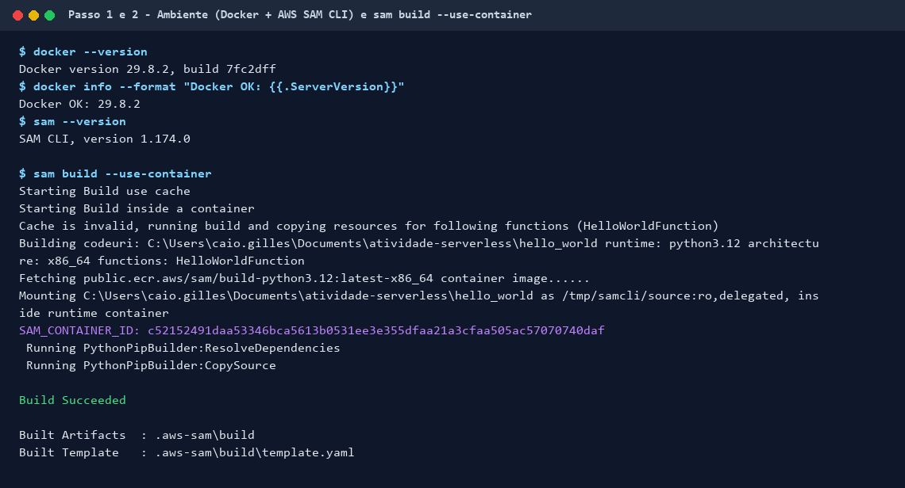
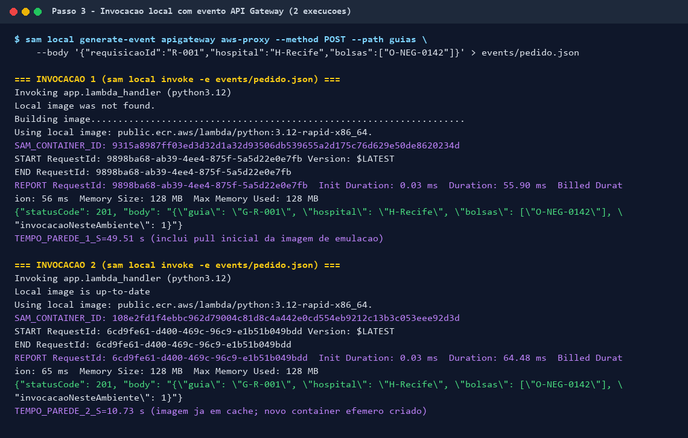
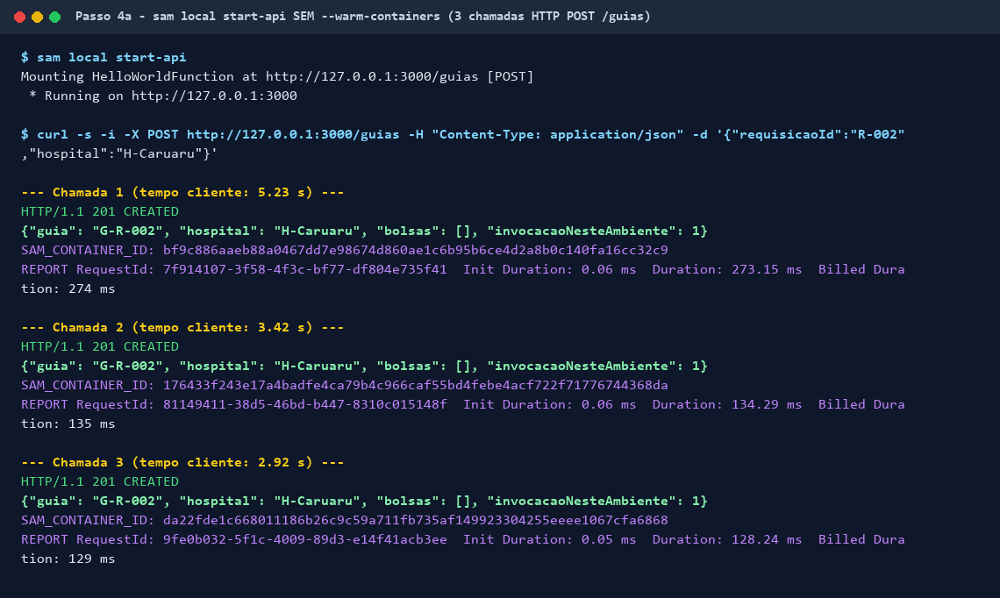
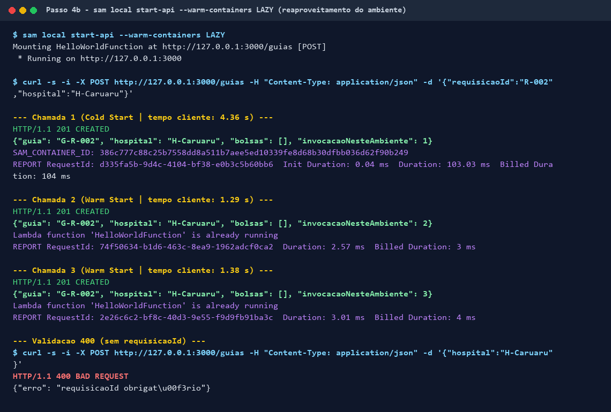
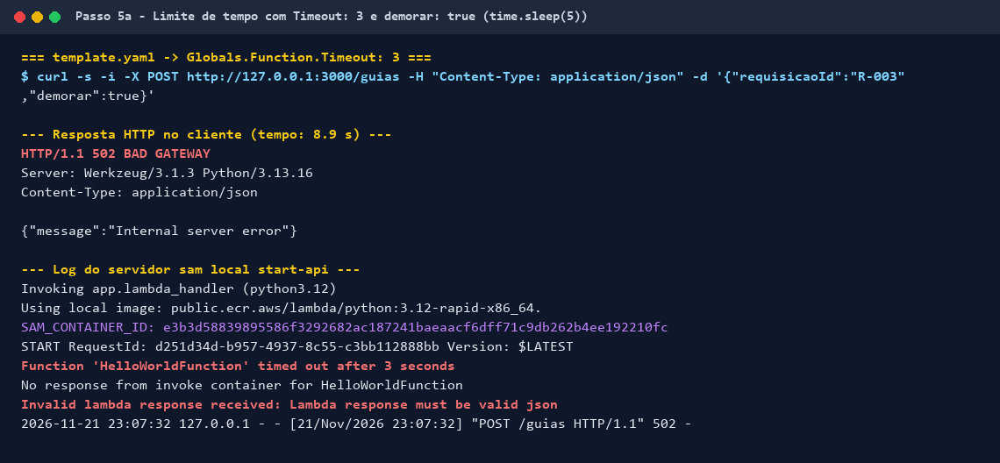
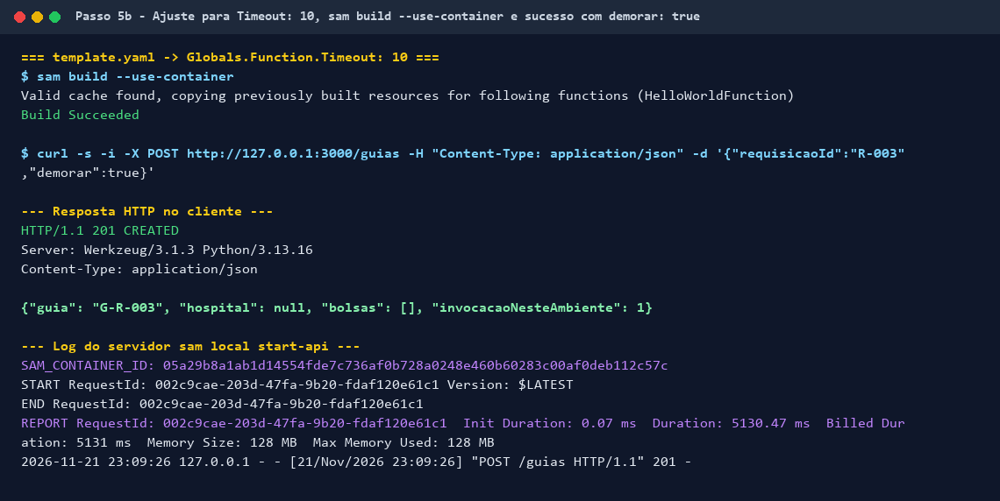

# Atividade Individual 1 — Serverless (Rota Vital)

**Disciplina:** Infraestrutura de Software · ADS · CESAR School · 2026.2  
**Estudante:** Caio Gilles  
**Caminho escolhido:** **Caminho A — AWS SAM CLI local** (Docker Desktop + Python 3.12, sem conta em provedor de nuvem)

---

## 1. Sobre o projeto

Função serverless acionada por **evento (API Gateway Proxy)** e por **HTTP (`POST /guias`)**, implementando a geração de guia de transporte de uma requisição do sistema **Rota Vital**.

O projeto foi criado com o AWS SAM CLI (`sam init`) e executado localmente em containers Docker oficiais da AWS (`public.ecr.aws/sam/build-python3.12` e `public.ecr.aws/lambda/python:3.12-rapid-x86_64`) para observar na prática:

- Ciclo de vida do ambiente de execução (*cold start*, fase de `Init` e reaproveitamento com `--warm-containers LAZY`);
- Ausência de garantia de estado em memória global (`invocacaoNesteAmbiente`);
- Comportamento e tratamento do limite de tempo de execução (`Timeout: 3` vs `Timeout: 10`).

### Estrutura do repositório

```text
atividade-serverless/
├── hello_world/
│   ├── app.py                  # Handler Lambda (POST /guias)
│   └── requirements.txt
├── events/
│   └── pedido.json             # Evento API Gateway Proxy gerado pelo SAM CLI
├── tests/
│   └── unit/
│       └── test_handler.py     # Testes unitários com pytest
├── evidencias/                 # Prints dos comandos executados e das saídas reais
├── template.yaml               # Definição SAM (POST /guias, Runtime python3.12, Timeout)
├── samconfig.toml              # Configuração SAM CLI local
└── README.md
```

---

## 2. Como reproduzir localmente

### Pré-requisitos

- **Docker Desktop** em execução (testado na versão `29.8.2`);
- **AWS SAM CLI** instalado (testado na versão `1.174.0`);
- **Git Bash** ou **WSL** no Windows (recomendado para evitar problemas de aspas/UTF-8 BOM com `curl` no PowerShell).

### Passo a passo

1. **Conferir ambiente e fazer o build dentro do container Python 3.12:**
   ```bash
   docker --version
   sam --version
   sam build --use-container
   ```

2. **Invocar a função com um evento API Gateway (Passo 3):**
   ```bash
   sam local generate-event apigateway aws-proxy --method POST --path guias \
     --body '{"requisicaoId":"R-001","hospital":"H-Recife","bolsas":["O-NEG-0142"]}' \
     > events/pedido.json

   sam local invoke -e events/pedido.json
   sam local invoke -e events/pedido.json
   ```

   > **Observação técnica (SAM CLI `1.174.0`):** nesta versão, `sam local generate-event apigateway aws-proxy` codifica o campo `body` em Base64 com `"isBase64Encoded": true`. O handler em `hello_world/app.py` decodifica automaticamente quando essa flag é verdadeira, mantendo compatibilidade tanto com o evento gerado quanto com requisições HTTP diretas.

3. **Acionar por HTTP sem reaproveitamento de container (Passo 4a):**
   ```bash
   # Terminal 1
   sam local start-api

   # Terminal 2 (repetir 3 vezes)
   curl -s -i -X POST http://127.0.0.1:3000/guias \
     -H "Content-Type: application/json" \
     -d '{"requisicaoId":"R-002","hospital":"H-Caruaru"}'
   ```

   > **Observação técnica (`samconfig.toml`):** o template inicial do SAM CLI `1.174.0` define `warm_containers = "EAGER"` por padrão em `[default.local_start_api.parameters]`. Essa configuração foi comentada no `samconfig.toml` para que `sam local start-api` rode sem containers aquecidos por padrão e a diferença para `--warm-containers LAZY` fique reproduzível exatamente como no roteiro.

4. **Acionar por HTTP com reaproveitamento de ambiente (Passo 4b):**
   ```bash
   # Terminal 1 (parar o anterior com Ctrl+C e subir com LAZY)
   sam local start-api --warm-containers LAZY

   # Terminal 2 (repetir 3 vezes)
   curl -s -i -X POST http://127.0.0.1:3000/guias \
     -H "Content-Type: application/json" \
     -d '{"requisicaoId":"R-002","hospital":"H-Caruaru"}'
   ```

5. **Testar o limite de tempo (Passo 5):**
   - Com `Timeout: 3` em `template.yaml`, enviar:
     ```bash
     curl -s -i -X POST http://127.0.0.1:3000/guias \
       -H "Content-Type: application/json" \
       -d '{"requisicaoId":"R-003","demorar":true}'
     ```
     A função executa `time.sleep(5)`, estoura o limite de 3 segundos e retorna `HTTP 502 Bad Gateway`.
   - Alterar `Timeout: 10` em `template.yaml` (estado atual do repositório), rodar `sam build --use-container`, reiniciar o `sam local start-api` e repetir o `curl`: agora retorna `HTTP 201 Created` após ~5,1 segundos.

6. **Rodar os testes unitários (opcional):**
   ```bash
   python -m pytest tests/unit/test_handler.py -v
   ```

---

## 3. Resultados observados e evidências

| Experimento | Comando / Cenário | Resultado observado | Evidência |
|---|---|---|---|
| **Ambiente e Build** | `docker --version`, `sam --version`, `sam build --use-container` | Docker `29.8.2`, SAM CLI `1.174.0`, `Build Succeeded` | [01-ambiente-versoes-build.png](evidencias/01-ambiente-versoes-build.png) |
| **Evento (Invocação 1)** | `sam local invoke -e events/pedido.json` | `49,51 s` (com pull da imagem), `Init: 0.03 ms`, `Duration: 55.90 ms`, `201`, `invocacaoNesteAmbiente: 1` | [02-passo3-invoke-evento.png](evidencias/02-passo3-invoke-evento.png) |
| **Evento (Invocação 2)** | `sam local invoke -e events/pedido.json` | `10,73 s` (imagem em cache, novo container), `Init: 0.03 ms`, `Duration: 64.48 ms`, `201`, `invocacaoNesteAmbiente: 1` | [02-passo3-invoke-evento.png](evidencias/02-passo3-invoke-evento.png) |
| **HTTP sem warm** | `sam local start-api` + 3× `curl` | `201` nas 3 chamadas (`5,23 s`, `3,42 s`, `2,92 s`), **3 containers diferentes**, `invocacaoNesteAmbiente: 1, 1, 1` | [03-passo4-http-sem-warm.png](evidencias/03-passo4-http-sem-warm.png) |
| **HTTP com LAZY** | `sam local start-api --warm-containers LAZY` + 3× `curl` | 1ª chamada: `4,36 s` (`Duration: 103.03 ms`, `Init: 0.04 ms`, contador `1`); 2ª e 3ª: `1,29 s` / `1,38 s` (`Duration: 2.57 ms` / `3.01 ms`, sem `Init`, contadores `2` e `3`) + validação `400` | [04-passo4-http-warm-lazy.png](evidencias/04-passo4-http-warm-lazy.png) |
| **Timeout 3 s (erro)** | `demorar: true` com `Timeout: 3` | `HTTP 502 Bad Gateway`; log: `Function 'HelloWorldFunction' timed out after 3 seconds` | [05-passo5-timeout-3s-erro.png](evidencias/05-passo5-timeout-3s-erro.png) |
| **Timeout 10 s (ajuste)** | `demorar: true` com `Timeout: 10` | `HTTP 201 Created` (`guia: G-R-003`), `Duration: 5130.47 ms`, `Billed Duration: 5131 ms` | [06-passo5-timeout-10s-sucesso.png](evidencias/06-passo5-timeout-10s-sucesso.png) |
| **Testes unitários** | `python -m pytest tests/unit/test_handler.py -v` | `3 passed in 0.90s` (`201`, `400`, Base64) | [07-testes-unitarios-pytest.png](evidencias/07-testes-unitarios-pytest.png) |

### Prints das execuções

#### Passo 1 e 2 — Ambiente e build


#### Passo 3 — Invocação local com evento (duas execuções)


#### Passo 4a — HTTP sem `--warm-containers`


#### Passo 4b — HTTP com `--warm-containers LAZY`


#### Passo 5a — Erro de limite de tempo (`Timeout: 3`)


#### Passo 5b — Ajuste para `Timeout: 10` e execução com sucesso


---

## 4. Respostas às perguntas

### 1. Por que a primeira invocação demorou mais que a segunda? O que acontece na fase de Init?

A primeira invocação sofre o chamado **cold start** (partida a frio). No teste local com `sam local invoke`, a 1ª execução levou **49,51 s** de tempo total porque, além de criar o ambiente de execução do zero, o SAM precisou baixar e construir a imagem de emulação (`public.ecr.aws/lambda/python:3.12-rapid-x86_64`); na 2ª execução a imagem já estava em cache local e o tempo caiu para **10,73 s**. Já no modo `sam local start-api --warm-containers LAZY`, o contraste entre *cold start* e *warm start* fica ainda mais evidente: a 1ª requisição levou **4,36 s** no cliente (`Duration: 103.03 ms` + `Init Duration: 0.04 ms`), enquanto a 2ª e a 3ª reaproveitaram o container já aberto e caíram para **1,29 s** / **1,38 s** no cliente, com apenas **2,57 ms** e **3,01 ms** de execução interna (sem fase de `Init`).

Na **fase de Init** do ciclo de vida do AWS Lambda, o provedor prepara o ambiente antes de chamar o handler:
1. Provisiona o ambiente isolado (microVM/container) e baixa/monta o pacote de código da função;
2. Inicializa o runtime escolhido (neste caso, Python 3.12) e eventuais extensões;
3. Executa o código de inicialização fora da função `lambda_handler` — no nosso `app.py`, os `import` (`base64`, `json`, `time`) e a inicialização da variável global `contador = 0`.

Só depois disso entra a fase de **Invoke**, executando o `lambda_handler`. Quando o ambiente é reaproveitado nas chamadas seguintes, a fase de `Init` é pulada.

---

### 2. O que o campo `invocacaoNesteAmbiente` mostrou com e sem `--warm-containers`? O que isso diz sobre guardar estado numa variável global da função?

- **Sem `--warm-containers`:** o campo retornou `1`, `1` e `1` nas três requisições. Nos logs do SAM, cada chamada gerou um `SAM_CONTAINER_ID` diferente (`bf9c886a...`, `176433f2...`, `da22fde1...`), ou seja, o container era destruído após responder e recriado zerado na requisição seguinte.
- **Com `--warm-containers LAZY`:** o campo retornou `1`, `2` e `3` sequencialmente, e os logs confirmaram o reaproveitamento do mesmo container (`386c777c...` com a mensagem `Lambda function 'HelloWorldFunction' is already running`).

Isso mostra que **não se deve armazenar estado de negócio em variáveis globais** de uma função serverless. A sobrevivência da memória entre chamadas não é garantida: a plataforma pode reciclar o ambiente após inatividade, encerrá-lo após um erro/timeout ou criar múltiplas instâncias simultâneas sob concorrência — cada uma com seu próprio `contador` zerado. Variáveis globais só fazem sentido para **reaproveitamento oportunista de inicialização** (como conexões/clientes de SDK ou cache descartável), nunca como fonte de verdade. Todo estado que precisa persistir (como numeração de guias, status de requisições ou estoque de bolsas) deve ficar em armazenamento externo (banco de dados, Redis, DynamoDB, S3, etc.).

---

### 3. O que aconteceu com `demorar = true`? Qual é o tempo máximo de uma execução no Lambda, e o que fazer com um trabalho mais longo?

Com `Timeout: 3` configurado em `Globals` no `template.yaml`, enviar `{"requisicaoId":"R-003","demorar":true}` disparou `time.sleep(5)`. Ao completar 3 segundos, o runtime interrompeu a função com o erro `Function 'HelloWorldFunction' timed out after 3 seconds` (`No response from invoke container for HelloWorldFunction`), fazendo o API Gateway local responder **`HTTP 502 Bad Gateway`** (`{"message":"Internal server error"}`). Depois de aumentar `Timeout` para `10` e executar `sam build --use-container`, a mesma requisição concluiu em **5130,47 ms** (`Billed Duration: 5131 ms`) e devolveu **`HTTP 201 Created`** com a guia `G-R-003`.

- **Tempo máximo de uma execução no AWS Lambda:** **15 minutos (900 segundos)** por invocação (e vale lembrar que, quando exposta de forma síncrona via **API Gateway REST**, o limite padrão da integração HTTP do API Gateway é de **29 segundos**).
- **O que fazer com trabalhos mais longos:**
  - **Processamento assíncrono com fila:** a requisição HTTP apenas valida e grava o pedido numa fila (ex.: Amazon SQS ou EventBridge), respondendo rápido (`202 Accepted`), enquanto workers processam em segundo plano;
  - **Quebrar em etapas orquestradas:** dividir um fluxo longo em funções menores coordenadas pelo **AWS Step Functions**;
  - **Mover para computação de longa duração:** para jobs contínuos ou muito demorados, usar serviços como **AWS Fargate / ECS**, **AWS Batch** ou instâncias dedicadas em vez de Lambda.

---

### 4. Com os preços de `us-east-1` da aula (US\$ 0,20 por milhão de requisições e US\$ 0,0000166667 por GB-s), quanto custa um milhão de execuções desta função com 128 MB e 100 ms? Mostrem a conta.

Dados:
- Quantidade de execuções: `1.000.000`
- Memória configurada: `128 MB` = `128 / 1024 GB` = **`0,125 GB`**
- Duração por execução: `100 ms` = **`0,1 s`**
- Preço por requisição: **`US$ 0,20` por `1.000.000` requisições**
- Preço de computação: **`US$ 0,0000166667` por `GB-s`**

Cálculo passo a passo:

1. **Custo de requisições:**
   ```text
   1.000.000 requisições × (US$ 0,20 / 1.000.000) = US$ 0,20
   ```

2. **Tempo total de computação:**
   ```text
   1.000.000 execuções × 0,1 s = 100.000 s
   ```

3. **Consumo total em GB-s:**
   ```text
   100.000 s × 0,125 GB = 12.500 GB-s
   ```

4. **Custo de computação:**
   ```text
   12.500 GB-s × US$ 0,0000166667 = US$ 0,20833375  (≈ US$ 0,21)
   ```

5. **Custo total (desconsiderando a faixa gratuita):**
   ```text
   US$ 0,20 + US$ 0,20833375 = US$ 0,40833375  (aproximadamente US$ 0,41)
   ```

> **Nota sobre o plano gratuito (Always Free):** o AWS Lambda inclui `1.000.000` de requisições e `400.000 GB-s` gratuitos por mês. Como esse cenário consome exatamente `1 milhão` de requisições e apenas `12.500 GB-s` (3,1% da cota), dentro da faixa gratuita o custo mensal seria **US$ 0,00**.

---

### 5. Em que parte do Rota Vital uma função assim faria sentido, e em qual não faria?

- **Onde faz sentido no Rota Vital:**
  - **Emissão de guia de transporte / comprovante em PDF** sob demanda quando uma requisição de sangue é aprovada;
  - **Notificações orientadas a evento** (envio de e-mail, SMS ou push para o hospital solicitante e para o motorista quando uma coleta é despachada ou entregue);
  - **Webhooks e integrações pontuais** com sistemas externos de hemocentros ou validação de payloads em picos irregulares de emergência;
  - **Auditorias e logs assíncronos** disparados por eventos de mudança de status de bolsas.  
  São tarefas curtas, sem estado local, acionadas por evento e com demanda variável — cenário em que pagar só por execução e escalar automaticamente traz ótimo custo-benefício.

- **Onde NÃO faz sentido no Rota Vital:**
  - **Monitoramento contínuo em tempo real** de localização GPS da ambulância e telemetria contínua de temperatura das bolsas de sangue via WebSocket/streaming persistente (exige conexões abertas de longa duração e estado de sessão);
  - **Cálculos pesados ou em lote de otimização de rotas** que precisem rodar por vários minutos ou exigir CPU/memória constante e previsível;
  - **Serviço transacional crítico de alta frequência e latência ultrabaixa 24/7** que depende de pool fixo de conexões com banco relacional, onde *cold starts* e abertura repetida de conexões prejudicam a previsibilidade e um container sempre ativo (ECS/Kubernetes) costuma ser mais adequado e até mais barato.

---

## 5. Uso de IA (PO-CESAR-021)

- **Ferramenta utilizada:** Antigravity (assistente de IA no ambiente local).
- **Finalidade:** apoio na configuração do AWS SAM CLI no Windows, ajuste do decodificador Base64 no `hello_world/app.py` (necessário para o formato gerado pelo `sam local generate-event` na v1.174.0), diagnóstico do `warm_containers = "EAGER"` padrão em `samconfig.toml`, escrita dos testes unitários em `pytest` e organização/revisão deste `README.md`.
- **Como validei:** todos os comandos foram executados de fato localmente sobre Docker Desktop + AWS SAM CLI (`sam build --use-container`, duas execuções de `sam local invoke`, `sam local start-api` com e sem `--warm-containers LAZY`, teste de `Timeout: 3` com erro `502` e reteste com `Timeout: 10` retornando `201`, além de `pytest`). Verifiquei os logs brutos, tempos, códigos HTTP, cada evidência em `evidencias/` e conferi manualmente todas as contas e conceitos técnicos antes de finalizar a entrega.
